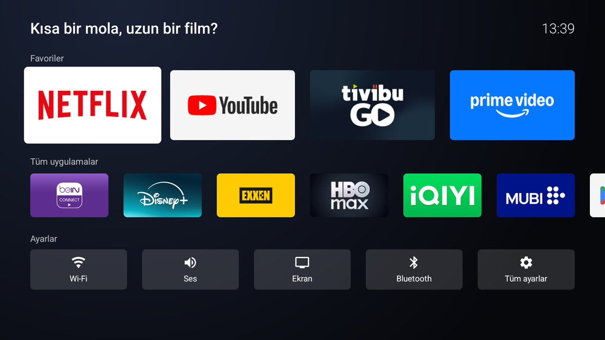

# Ana Ekran

Next 4K Google TV Stick (Android 14) ve Xiaomi Mi TV Stick (Android 9) için kendi ana ekranım: internet izni yok, dış kütüphane yok.



Tasarım: `docs/superpowers/specs/2026-11-15-tv-launcher-design.md`

## Kurulum

### Gerekenler

- Android 9 (API 28) veya üstü bir Android TV / Google TV cihazı
- Bilgisayarda JDK 17, Android SDK (`local.properties` içinde `sdk.dir=...`) ve `adb`
- TV ile bilgisayar aynı ağda

### 1. TV'de ağ üzerinden hata ayıklamayı aç

1. Ayarlar > Sistem > Hakkında > **Android TV OS derlemesi**'ne 7 kez bas. Geliştirici seçenekleri açılır.
2. Ayarlar > Sistem > Geliştirici seçenekleri > **USB hata ayıklama**'yı aç (Android 11+ cihazlarda **Kablosuz hata ayıklama** da olabilir).
3. TV'nin IP adresini not et: Ayarlar > Ağ ve İnternet > bağlı ağ.

### 2. Bağlan

```bash
adb connect <TV_IP>:5555
export ANDROID_SERIAL=<TV_IP>:5555
```

TV'de çıkan "USB hata ayıklamaya izin verilsin mi?" penceresinde **İzin ver**'i seç.

### 3. Derle ve kur

```bash
./gradlew :app:assembleRelease
adb install -r app/build/outputs/apk/release/app-release.apk
```

### 4. Ana ekran yap

```bash
adb shell cmd package set-home-activity dev.anaekran/.HomeActivity
```

Bazı cihazlarda orijinal ana ekran yine öne çıkar. O zaman orijinal ana ekranı kapat:

- Google TV (Next, Android 14):
  ```bash
  adb shell pm disable-user --user 0 com.google.android.apps.tv.launcherx
  adb shell pm disable-user --user 0 com.google.android.tungsten.setupwraith
  ```
- Android TV (Xiaomi, Android 9):
  ```bash
  adb shell pm disable-user --user 0 com.google.android.tvlauncher
  ```

HOME tuşuna bas; yeni ana ekran açılır.

### 5. İşin bitince

Ağ üzerinden hata ayıklama açık kalırsa ağdaki başka biri cihaza bağlanmayı deneyebilir. Kurulumdan sonra Geliştirici seçenekleri'nden **USB hata ayıklama**'yı kapat.

## Kullanım

- **OK**: uygulamayı aç
- **OK'a uzun bas**: menü (favorilere ekle/çıkar, sırala, gizle, uygulama bilgisi, kaldır)
- **Tüm ayarlar'a uzun bas**: gizli uygulamalar
- Uygulama kaldırma her zaman sistemin onay penceresinden geçer.

## Geri dönüş

Orijinal ana ekranı geri aç, sonra bu uygulamayı kaldır:

- Google TV (Next):
  ```bash
  adb shell pm enable com.google.android.apps.tv.launcherx
  adb shell pm enable com.google.android.tungsten.setupwraith
  ```
- Android TV (Xiaomi):
  ```bash
  adb shell pm enable com.google.android.tvlauncher
  ```

```bash
adb uninstall dev.anaekran
```

## Testler

```bash
./gradlew :app:testDebugUnitTest
```

## English

**Ana Ekran** ("home screen" in Turkish) is a minimal, ad-free home screen (launcher) for Android TV and Google TV, built for a Next 4K Google TV Stick (Android 14) and a Xiaomi Mi TV Stick (Android 9). The UI text is in Turkish.

- No internet permission, no third-party libraries: plain Kotlin and Android Views. The release APK is under 100 KB.
- A colorful intro animation on every boot or wake, then a time-of-day greeting.
- Rows: Favorites (4 defaults, reorderable), All apps, and quick Settings tiles (Wi-Fi, Sound, Display, Bluetooth, All settings).
- Long-press OK on an app for a menu: add/remove favorite, move, hide, app info, uninstall. Uninstalling always goes through the system confirmation dialog.
- A lighter intro on devices with less than 1.5 GB RAM.

### Setup

Requirements: an Android TV device running Android 9 (API 28) or newer, and JDK 17, the Android SDK and `adb` on your computer.

1. On the TV, enable Developer options and turn on USB debugging.
2. Connect, build and install:
   ```bash
   adb connect <TV_IP>:5555
   export ANDROID_SERIAL=<TV_IP>:5555
   ./gradlew :app:assembleRelease
   adb install -r app/build/outputs/apk/release/app-release.apk
   adb shell cmd package set-home-activity dev.anaekran/.HomeActivity
   ```
3. If the stock launcher still comes back, disable it with `adb shell pm disable-user --user 0 <package>`. The package names are in the Turkish steps above. Re-enable it later with `adb shell pm enable <package>`.
4. When you are done, turn USB debugging off again.

## Lisans

[MIT](LICENSE)
